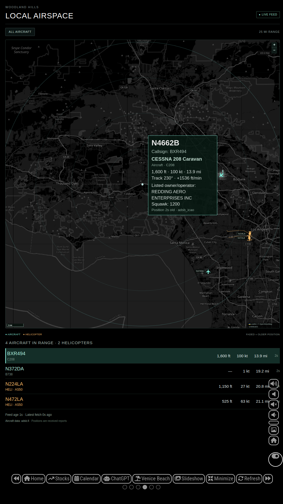
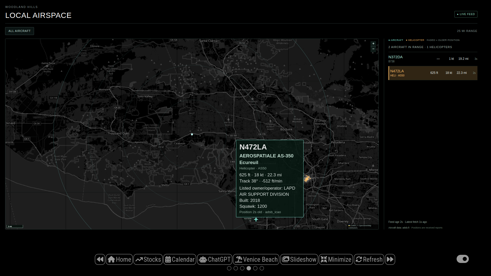

# MMM-LiveRadar

Live aircraft and helicopter radar for [MagicMirror²](https://magicmirror.builders/). See nearby traffic on a dark map, hover over an aircraft for its details and find the matching aircraft in the information panel.

No ADS-B receiver or antenna is required. The module uses the [adsb.fi](https://adsb.fi/) public internet feed. Leaflet is bundled locally, so installing the module does not require `npm install`.

## Screenshots

### Portrait fullscreen with hover details

<a href="docs/images/portrait-hover.png"></a>

*Direct screen capture: aircraft registration, model, live flight details and linked row highlighting. Click the image to view it at full resolution.*

### Landscape fullscreen



*Direct screen capture: helicopter hover details and the matching highlighted aircraft in the information panel on the right.*

## Features

- Airplane and helicopter icons that follow the reported ground track
- Compact portrait, portrait fullscreen and landscape fullscreen layouts
- Landscape information panel on the left or right
- Hover cards with a large registration and aircraft details
- A highlighted aircraft row and trail that follow the selected aircraft
- Click/tap details for touchscreen displays
- A helicopter-only filter
- Flight trails drawn from received positions
- Configurable starting zoom and local search radius
- Position ages, faded older reports and automatic removal of expired positions

Cards show registration, callsign, model/type, altitude, groundspeed, track, distance and position age. Vertical rate, squawk, a listed owner/operator and build year appear when available. Missing details are omitted.

## Requirements

- A working MagicMirror² installation with a modern Electron/Chromium browser
- Node.js 20 or newer is recommended for new installations
- Internet access to `opendata.adsb.fi` and, if enabled, `tile.openstreetmap.org`

## Install

From your existing MagicMirror `modules` directory:

```bash
cd /home/pi/MagicMirror/modules
git clone https://github.com/Dresch360/MMM-LiveRadar.git
```

Adjust the path if your installation is elsewhere. The expected result is:

```text
MagicMirror/modules/MMM-LiveRadar/MMM-LiveRadar.js
```

Add one of the following entries inside the existing `modules: [ ... ]` array in `config/config.js`. Keep commas between module entries. Do not replace your complete configuration.

### Compact portrait

```javascript
{
  disabled: false,
  module: "MMM-LiveRadar",
  position: "bottom_right",
  config: {
    latitude: 34.1683,
    longitude: -118.6059,
    locationLabel: "WOODLAND HILLS",
    rangeMiles: 25,
    width: 460,
    mapHeight: 380,
    maxFlights: 6
  }
},
```

The coordinates above are approximate town-center coordinates. Set your own map center and label.

### Portrait fullscreen

```javascript
{
  disabled: false,
  module: "MMM-LiveRadar",
  position: "fullscreen_above",
  config: {
    latitude: 34.1683,
    longitude: -118.6059,
    locationLabel: "WOODLAND HILLS",
    layout: "portrait",
    fullscreen: true,
    rangeMiles: 25,
    zoomLevel: null,
    startupZoomOffset: 1,
    maxFlights: 8
  }
},
```

The map sits above the aircraft list. Larger list fonts are included for this layout.

### Landscape fullscreen

```javascript
{
  disabled: false,
  module: "MMM-LiveRadar",
  position: "fullscreen_above",
  config: {
    latitude: 34.1683,
    longitude: -118.6059,
    locationLabel: "WOODLAND HILLS",
    layout: "landscape",
    fullscreen: true,
    infoSide: "right",
    sidebarWidth: 430,
    rangeMiles: 25,
    zoomLevel: null,
    startupZoomOffset: 1,
    maxFlights: 12
  }
},
```

Set `infoSide: "left"` to move the information panel. Use one fullscreen instance per page. Layout settings arrange the module; they do not rotate the operating system's display.

Full sample entries are also included in `config.portrait-fullscreen.js` and `config.landscape-fullscreen.js`. If you use MMM-pages or profile switching, add the module to the appropriate page/profile using your existing setup.

Check configuration syntax, then restart using your normal MagicMirror startup method:

```bash
node --check /home/pi/MagicMirror/config/config.js
```

## Hover and touch controls

Hover over an aircraft icon to show its information card, emphasize its icon/trail and highlight its matching row. If the aircraft is outside the normal list limit, its row temporarily replaces the last row. The list scrolls to the selected row when needed.

Click or tap an aircraft to open its details and retain the selection. Click the map background to clear the selection. The All Aircraft button switches between all recent traffic and identified helicopters.

Cards use 34px registration text, a 22px model heading and 20px body text. Some secondary fields use 16px text. External CSS scaling can affect the apparent size.

## Starting zoom

Set a fixed initial zoom in the module's `config`:

```javascript
zoomLevel: 11,
```

Levels 1 through 19 are accepted. Higher numbers zoom closer. A fixed zoom takes precedence over `startupZoomOffset`.

For automatic fitting:

```javascript
zoomLevel: null,
startupZoomOffset: 1,
```

Offset `1` starts one level closer after fitting the range. Set it to `0` for the original full-range view. The offset is clamped between -3 and 3. Changing zoom does not change the aircraft search radius. The map's + and - buttons remain available.

## Settings

| Setting | Default | Description |
| --- | --- | --- |
| `latitude`, `longitude` | `34.1683`, `-118.6059` | Map center and search location |
| `locationLabel` | `WOODLAND HILLS` | Text above the map |
| `rangeMiles` | `25` | Search radius in statute miles, 1–250 |
| `updateInterval` | `2000` | Pause in milliseconds after a request completes; minimum 1500 |
| `layout` | `portrait` | `portrait` or `landscape` |
| `fullscreen` | `false` | Fill the viewport; use `fullscreen_above` |
| `infoSide` | `right` | Landscape panel on `left` or `right` |
| `sidebarWidth` | `430` | Preferred landscape panel width in pixels |
| `fullscreenPadding` | `24` | Fullscreen inner padding in pixels |
| `width`, `mapHeight` | `460`, `380` | Compact-mode dimensions in pixels |
| `zoomLevel` | `null` | Fixed initial zoom, or automatic fitting |
| `startupZoomOffset` | `1` | Zoom steps after automatic fitting |
| `maxFlights` | `6` | Maximum aircraft rows; does not limit map icons |
| `helicoptersOnly` | `false` | Start with identified helicopters only |
| `showLabels`, `maxLabels` | `true`, `8` | Normal labels for the nearest aircraft; hover details still work |
| `showTrails` | `true` | Draw paths through positions actually received |
| `trailMinutes` | `3` | Trail history length |
| `staleAfter` | `15` | Fade position reports older than this many seconds |
| `maxPositionAge` | `60` | Remove older reports; server accepts 10–300 seconds |
| `useMapTiles` | `true` | Enable the background map |
| `includeGround` | `false` | Include reports explicitly identified as on the ground |

Groundspeed is shown in knots, altitude in feet and distance in statute miles. "Track" is the reported direction over the ground, which can differ from nose heading.

## Live data

Aircraft positions come from the adsb.fi community receiver network. Each aircraft shows its position age; older reports fade and expire automatically. Coverage and update latency depend on the available feed.

The default refresh pause is two seconds. Instances with matching feed settings share one poller within the same MagicMirror process.

## Standalone preview and feed check

From the module directory:

```bash
node preview-server.js
```

Open these URLs on that same computer:

| Preview | URL |
| --- | --- |
| Compact | http://127.0.0.1:8099/ |
| Portrait fullscreen | http://127.0.0.1:8099/?layout=portrait&fullscreen=1 |
| Landscape, right panel | http://127.0.0.1:8099/?layout=landscape&fullscreen=1&side=right |
| Landscape, left panel | http://127.0.0.1:8099/?layout=landscape&fullscreen=1&side=left |

The preview uses the Woodland Hills defaults and listens only on localhost. Ctrl+C stops it. Avoid running a second poller alongside an active mirror on the same connection during testing.

For one feed diagnostic request:

```bash
node check-feed.js
```

Optional arguments are latitude, longitude and radius in miles:

```bash
node check-feed.js 34.1683 -118.6059 25
```

## License, data and attribution

Module source: [MIT](LICENSE). Bundled Leaflet 1.9.4: [BSD-2-Clause](vendor/LEAFLET-LICENSE.txt).

Aircraft data: [adsb.fi](https://adsb.fi/). Its public API is for personal, non-commercial use and requires visible attribution. Contact the provider for commercial permission. See its [API documentation and terms](https://github.com/adsbfi/opendata). The module's MIT license does not grant rights to third-party data or services.

Map data and tiles: © [OpenStreetMap contributors](https://www.openstreetmap.org/copyright). Normal browser caching is retained and only the visible map is requested. Follow the [tile usage policy](https://operations.osmfoundation.org/policies/tiles/); service availability is not guaranteed.
